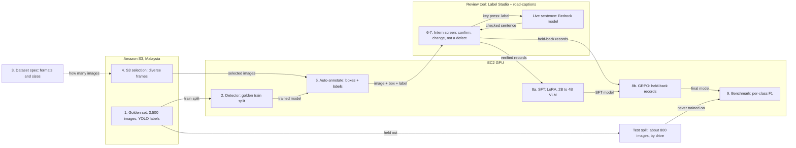
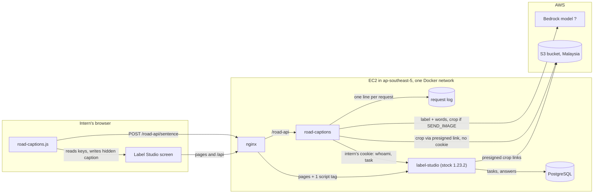

# Road Damage VLM Plan

Your 9-step plan, checked against Papers With Code. Updated 5 Nov 2026: the intern screen now writes sentences live (see "Intern screen and review tool").

**Verdict: viable.** Every step has published precedent. One blocker and three major changes keep the SFT and GRPO datasets clean. The plan uses about 13% of the RM 8,000 AWS credit.

**Task for the VLM:** input an image with one bounding box. Output the defect name (pothole, crack, raveling) or "no defect", plus one short line. No severity. The VLM never adds boxes: it confirms or denies the Detector's boxes.

---

## 1. Your plan



### Walkthrough

1. Golden set: check the labels, then lock about 800 images by drive as the Test split.
2. Detector trains on the remaining golden images.
3. Dataset spec fixes the SFT and GRPO record formats and the target number of records.
4. S3 selection picks diverse frames, enough to reach the target number of records.
5. Auto-annotate runs the Detector and keeps its boxes and labels.
6. Intern screen: one key per box confirms, changes the label, or marks "not a defect". The sentence is written live by a Bedrock model for the confirmed label.
7. Rejected Detector boxes and look-alikes become the "no defect" records.
8. SFT trains on most verified records. GRPO then trains on held-back uncertain records.
9. Benchmark scores the final model on the Test split only.

### Summary

| Item | Value |
|---|---|
| SFT record | Image with the box, the question, and the full answer: label plus sentence |
| GRPO record | Image with the box, the question, and the correct label only. No sentence. The model writes its own answers, and a reward scores them. |
| Records per class | SFT round 1: 1,000 per defect class and 1,500 "no defect". GRPO: 250 uncertain records per class. Test: at least 250 boxes per class. A learning curve decides round 2. |
| AWS spend | About USD 260 (RM 1,050), 13% of the credit |

---

## 2. Step check

| Step | Verdict | Change | Grounding |
|---|---|---|---|
| 1. Check golden set | Add one task | Lock a Test split of about 800 images by drive. Check labels where the Detector disagrees with them. | Popular benchmark test sets average at least 3.3% wrong labels (Northcutt 2021). Cleaned COCO labels trained better detectors (Singh 2024). |
| 2. Train detector | OK | Train RF-DETR next to a bigger YOLO; keep the one with higher recall. | Fine-tuned RF-DETR: 58.6–63.5 mAP over 100 small datasets (RF100-VL leaderboard). RDD2022 adds 47,420 road images (Arya 2022). |
| 3. Dataset spec | Needs numbers | SFT = full answer. GRPO = correct label only. Sizes in section 3. | SFT then GRPO for defect questions (JUDO 2026). GRPO data needs varied answers (MMR1 2025; WeVisOne-VL 2026). |
| 4. S3 selection | Add one rule | Remove near-duplicate frames before choosing. Spread picks across drives, lighting and road types. | Embedding deduplication removed 50% of a LAION subset with minimal loss (Abbas 2023). Uncertain plus diverse selection (Yang 2022). |
| 5. Auto-annotate | OK | Keep the Detector's boxes. The VLM only confirms or denies them. | Detectors propose boxes and a VLM verifies each one (WeVisOne-VL 2026, §2.2). |
| 6. Intern screen + Bedrock sentence | Change | One key per box makes one record. Allow "change label" and "not a defect". The model writes from the confirmed label. No separate GRPO button. | Verifying machine boxes cut annotation time 6–9× (Papadopoulos 2016). LLM text from structured labels, then expert review (PaveBench 2026). |
| 7. No defect | Change | Take "no defect" boxes from rejected Detector boxes and look-alikes (manholes, water). Aim for 30–40% of records. | Reviewed negatives with an empty answer; RL rewards a negative only when the model predicts nothing (WeVisOne-VL 2026, §2.5, §4.2). Questions about absent damage (PaveBench 2026). |
| 8. SFT, then GRPO | OK | Run GRPO on held-back records where the SFT model's answers still vary. Rule-based reward. | RL beats SFT with little data (Visual-RFT 2025). RL generalizes better; watch reward hacking (VLM-R1 2025). SFT then GRPO (Rex-Omni 2025). |
| 9. Benchmark | Needs the step 1 split | Score only on the Test split. Compare with the Detector alone, the zero-shot VLM and SFT-only. | A fixed monitoring set stays out of training (WeVisOne-VL 2026, §2.7). Zero-shot VLMs 55–65% vs 83–93% after LoRA (PaveBench 2026). |

---

## 3. SFT and GRPO data

Both datasets come from the same verified records. They differ in what a record must contain.

### SFT record

The model copies a full answer.

```json
{"messages": [
  {"role": "user", "content": "<image>Is there a road defect inside the red box? Answer as JSON with label and caption."},
  {"role": "assistant", "content": "{\"label\": \"raveling\", \"caption\": \"Raveling: loose stones and rough surface.\"}"}],
 "images": ["crops/d0390_f007702_b1.jpg"]}
```

A "no defect" answer: `{"label": "no_defect", "caption": "No defect: manhole cover on intact asphalt."}`

### GRPO record

The model writes several answers (for example 8). A reward scores each one. A record needs only the image with the box, the question and the correct label.

```json
{"messages": [{"role": "user", "content": "<image>Is there a road defect inside the red box? Answer as JSON with label and caption."}],
 "images": ["crops/d0388_f004121_b2.jpg"], "solution": "crack"}
```

Reward (`reward.py`): 0.2 for valid JSON with a known label, +0.8 for the correct label, −0.2 if the caption breaks a caption rule. The GRPO reward checks the label, not the sentence, so GRPO needs no written sentence. The sentence style is learned in SFT.

### Labels and caption rules

Labels: `pothole`, `crack`, `raveling`, `no_defect`. Manhole and stagnant water boxes become `no_defect`, with the look-alike named in the sentence.

Caption rules (same in review and in the GRPO reward):
- 15 words or fewer.
- Names its own label (a word that starts with pothole / crack / ravel), or starts with "No defect".
- Names no other defect. A "no defect" sentence names no defect at all.
- No severity or size words (severe, minor, major, large, small, deep, shallow, dangerous, huge, tiny).
- No numbers.

### Records per class

No paper gives a record count for road damage. The papers give a floor, a scale, and a method to measure your own number.

| Set | Pothole, crack, raveling (each) | No defect | Total | Why |
|---|---|---|---|---|
| Test split (step 1) | ≥ 250 boxes | ≥ 250, every look-alike type present | ≥ 1,000 | At 80% accuracy, 250 boxes give a 95% margin of ±5 points; 700 give ±3. Test sets average ≥ 3.3% wrong labels (Northcutt 2021): double-check these. |
| SFT round 1 | 1,000 | 1,500 (≥ 150 per look-alike type) | 4,500 | With 4 per class, SFT still scored slightly below the base model while RL gained 25.9 points (Visual-RFT 2025). Fine-tuned SAM 3: 36.5 mAP at 10 per class vs 61.6 with full data (RF100-VL). |
| SFT round 2 (only classes still improving) | +1,000 | +1,000 | up to 8,500 | Collecting in rounds kept collection within about 1.5× the minimum (Mahmood 2022). |
| GRPO | 250 uncertain | 250–400 | 1,000–1,150 | RL gained with 1–16 examples per class (Visual-RFT 2025). Only records where the 8 answers disagree teach anything (MMR1 2025; WeVisOne-VL 2026): draw them from about 800 held-back candidates per class. |
| S3 images (step 4) | about 4k–5k images for round 1 and GRPO candidates | | | Assumes about 2 boxes per image. For a rare class, select images where the Detector predicts it (WeVisOne-VL 2026, §2.1). |

### How to decide round 2

1. Train SFT on 250, 500 and 1,000 records per class.
2. Plot each class's F1 on the Test split against records per class (log scale).
3. Collect round 2 only for classes that gained more than 2 points from 500 to 1,000.
4. Stop adding data to a class when one doubling adds less than 2 points.
5. After SFT, count uncertain GRPO records per class. Almost none: the class needs no GRPO. Mostly wrong answers: it needs more SFT data.

Error usually falls as a power law of data size (Hestness 2017). Fits from 10% of the data diverged; fits from 50% tracked the real curve (Mahmood 2022).

Not verified: these counts are starting points from the sources, not results on your data.

### Why GRPO needs uncertain records

GRPO learns from the difference between the model's own answers to one record. If all 8 answers are right, or all are wrong, the difference is zero and the record teaches nothing. Select with U = 4μ(1−μ)σ over 8 sampled answers (WeVisOne-VL 2026; MMR1 2025).

---

## 4. Intern screen and review tool (live sentences)

Built and tested: stock Label Studio 1.23.2, plus a separate `road-captions` container behind nginx. No Label Studio code change. Code: `road/label_studio/` (see its README).



### Keys

| Key | Sentence | Model calls |
|---|---|---|
| `1` correct | Detector's label. Asked in advance 0.6 s after the task opens, so it is usually ready. Manhole / stagnant water: fixed "No defect: ..." sentence. | 1 (in advance) |
| `2` `3` `4` | Pothole, crack or raveling, written from the crop | 1 per change |
| `5` then `q`–`y` | Fixed "No defect: ..." sentence for manhole, standing water, shadow, patch, road marking, intact asphalt | 0 |
| `5` then `u` (other) | "No defect: ..." written from the crop | 1 |
| words + `Enter` | Rewrite that keeps every typed word. Text only, no crop. | 1 per pause |
| `6` bad box, `7` unsure | No sentence. Bad box is dropped; unsure goes to QA. | 0 |

`Ctrl+Enter` submits. Submit stays blocked until a valid sentence exists (hidden required field). A failed model sentence falls back to a template. Words that name another defect are refused with a message.

### Flow of one key press

1. Intern presses a key. `road-captions.js` clears the hidden caption, so submit is blocked.
2. It posts task, key and typed words to `/road-api/sentence` through nginx.
3. `road-captions` asks Label Studio, with the intern's cookie, who this is and whether they may open the task.
4. It fetches the crop through the presigned S3 link, without the cookie.
5. It sends the prompt and crop to the Bedrock model and gets one sentence.
6. It checks the sentence with the `reward.py` rules; on failure it uses the template.
7. The module shows the sentence and writes the hidden caption. Submit is allowed.
8. Label Studio saves key, words and sentence in PostgreSQL.

### Workflow around the tool

- One shared project for all reviewers. Label Studio locks open tasks and never serves a task twice to one intern.
- About 5% golden tasks mixed in (from the golden train split, never the Test split). Answers only in `golden_answers.json`.
- 10% overlap and random order through one API call (`maximum_annotations: 2`, `overlap_cohort_percentage: 10`, `sampling: "Uniform sampling"`).
- Each evening: export JSON, run `ls_export_to_jsonl.py` → `verified`, `sft`, `grpo_candidates`, `qa`, `dropped`, plus golden accuracy per intern and overlap agreement.
- The 2 QA leads work through `qa.jsonl` and spot-check 10% of `verified.jsonl`.

### Throughput

Assumption: 11 interns × 3 days × 6 hours = 198 hours. At 6–10 s per box: about 71k–119k box checks. Not verified: seconds per box; measure on day 1. Spare time goes to double-checking the Test split and the overlap boxes.

### Data residency

| Setting | What leaves Malaysia |
|---|---|
| No model ID | Nothing; template sentences only |
| `SEND_IMAGE=false` (default) | Label and typed words, for rewrites only |
| `SEND_IMAGE=true` | Each crop, for model sentences. A cross-region inference profile can process it outside Malaysia. |

### Tested / not tested

- Tested: 18/18 browser checks (Chromium) on the full Docker stack with a fake model; 43 unit tests; the export went through the converter (3 verified, 1 QA, 1 dropped).
- Not tested: a real Bedrock call (speed and cost unknown), a real S3 bucket (mocked presigned redirect only).

---

## 5. Changes to your plan

**Blocker — steps 1 and 9: test set.** Step 9 needs a test set, but no step sets one aside. Test images seen in steps 2 or 8 make scores look better than real accuracy. Fix: in step 1, lock about 800 golden images by drive. Never train on them. Double-check their labels.

**Major — step 6: GRPO button and GRPO sentence.** GRPO does not train on given sentences; it scores the model's own answers against the correct label. Fix: one key per box. GRPO uses only the label. Select GRPO records automatically after SFT.

**Major — step 7: source of "no defect".** An image with no defect has no box to ask about, so the VLM rarely learns to deny. Fix: take most "no defect" records from boxes interns reject, plus manhole and water boxes. Aim for 30–40% of records.

**Major — step 6: label control.** If interns can only accept, Detector label errors flow into training. Fix: "change label" and "not a defect" keys. The model writes the sentence from the confirmed label.

**Minor — steps 2 and 5: missed damage.** The VLM only checks boxes, so damage the Detector misses stays missing. Fix: report the Detector's per-class recall on the Test split in step 9.

**Minor — step 6: Bedrock.** From Malaysia, Bedrock models run through cross-region profiles, and credit coverage for third-party models is not verified. Fix: get approval for data leaving Malaysia; run 100 crops, then check Cost Explorer. Templates are the in-region fallback.

### Your steps with the changes

1. Check the golden labels and lock about 800 images by drive as the Test split.
2. Train the Detector on the rest. Compare RF-DETR and a bigger YOLO.
3. Fix the record formats and starting sizes from section 3.
4. Deduplicate S3 frames, then select about 5k–8k diverse images.
5. Auto-annotate the selected images with the Detector.
6. Interns press one key per box in the review tool; the sentence is written live and checked.
7. Rejected boxes and look-alikes become "no defect" records.
8. Run SFT on most records, then GRPO on uncertain held-back records.
9. Benchmark on the Test split against the Detector, the zero-shot VLM and SFT-only.

---

## 6. Budget

RM 8,000 ≈ USD 1,970 at 4.06 MYR per USD (rate of 30 Oct 2026).

| Step | Basis | GPU-h | Est. USD |
|---|---|---|---|
| 2. Detector | RF-DETR and a bigger YOLO, about 15 GPU-hours each | 30 | 56 |
| 5. Auto-annotate | 5k–8k images | 2 | 4 |
| 6. Bedrock sentences | 20k crops, Sonnet 5.5 (batch estimate; live calls cost about 2× batch) | — | 16 |
| 8a. SFT | 3 LoRA runs (25%, 50%, 100%) × about 8 GPU-hours | 24 | 45 |
| 8b. GRPO | Picking uncertain records, then GRPO with 8 answers per record | 40 | 74 |
| 9. Benchmark | Detector, zero-shot VLM, SFT-only and final model | 8 | 15 |
| Review tool, storage, transfer | Small instance for a week, S3, other | — | 50 |
| **Total** | About 13% of the credit; about RM 6,950 in reserve | 104 | **≈ 259** |

Not verified: GPU hours are estimates, priced at $1.86/h (us-east-1 g6e.xlarge, one L40S). A G6 (one L4) in Malaysia should cost less. GRPO on a 4B model may need more than one 24 GB GPU.

Sentence cost per 20,000 boxes (about 700 input + 100 output tokens each, not verified), at Anthropic list prices: Claude Haiku 5.5 about USD 2–3; Claude Sonnet 5.5 about USD 48 live (about USD 16–24 in batch, depending on tokens). Bedrock sets its own prices.

---

## 7. What the research says

- **Steps 1, 9 — check labels.** Ten popular test sets average ≥ 3.3% wrong labels (Northcutt 2021). Cleaned COCO labels trained better detectors (Singh 2024).
- **Step 2 — specialist detector.** Fine-tuned RF-DETR: 58.6–63.5 mAP50-95 over 100 small datasets (RF100-VL). RDD2022: 47,420 road images, 55,000+ instances (Arya 2022).
- **Step 4 — diverse frames.** Embedding deduplication removed 50% of a LAION subset with minimal loss (Abbas 2023). Uncertain then diverse selection (Yang 2022).
- **Step 5 — detector boxes, VLM verdict.** WeVisOne-VL: detectors propose boxes, Qwen3-VL checks each one, boxes are kept (2026). ChatRex: choosing among proposal boxes beats free box output (Jiang 2024).
- **Step 6 — verify, don't draw.** Yes/no checks of machine boxes cut annotation time 6–9× (Papadopoulos 2016). One good box ≈ 35 s; four clicks ≈ 7 s (Papadopoulos 2017).
- **Step 6 — facts first, then the model writes.** PaveBench: labels → JSON → LLM-written Q&A → expert review (Li 2026). LLaVA: text-only GPT-4 from captions and boxes (Liu 2023).
- **Step 7 — teach the model to say no.** WeVisOne-VL hard negatives with empty answers; RL rewards a negative only when nothing is predicted. PaveBench adds questions about absent damage.
- **Step 8 — SFT then GRPO for defects.** JUDO beats Qwen2.5-VL-7B and GPT-4o on MMAD (Kang 2026). AD-FM: GRPO for industrial defects (Liao 2025).
- **Steps 3, 8 — GRPO needs varied answers.** MMR1: gradient vanishes with low reward variance (Leng 2025). WeVisOne-VL: U = 4μ(1−μ)σ.
- **Steps 3, 8 — RL works with little data.** Visual-RFT: +24.3% one-shot classification with about 100 samples (Liu 2025). VLM-R1: RL generalizes better; reward hacking seen (Shen 2025).
- **Step 8 — why fine-tune.** PaveBench LoRA: Qwen2.5-VL-3B 65.2 → 88.2%, DeepSeek-VL2-small 55.5 → 93.0%, LLaVA-OneVision-7B 60.9 → 83.0%. RF100-VL: zero-shot VLMs under 2% on hard sets.
- **Step 8 — base models.** WeVisOne-VL 2B and 4B on Qwen3-VL (Liang 2026). Qwen3-VL dense 2B, 4B, 8B (Bai 2025). Start with 2B on an L4; check licenses.

---

## 8. Open decisions

1. Bedrock model ID (and whether credits cover it).
2. `SEND_IMAGE`: allow crops to leave Malaysia, or use template sentences for keys 1–4.
3. Run the review tool on EC2 with the real model and 10 tasks; measure seconds per sentence and per box.

---

## Sources

- Northcutt et al. 2021, Pervasive Label Errors in Test Sets. arXiv 2103.14749
- Singh et al. 2024, Benchmarking Object Detectors with COCO. arXiv 2403.18819
- Robinson et al. 2025, RF-DETR. arXiv 2511.09554
- Arya et al. 2022, RDD2022. arXiv 2209.08538
- Abbas et al. 2023, SemDeDup. arXiv 2303.09540 · Yang et al. 2022, PPAL. arXiv 2211.11612
- Liang et al. 2026, WeVisOne-VL. arXiv 2610.31329
- Jiang et al. 2024, ChatRex. arXiv 2411.18363 · Jiang et al. 2025, Rex-Omni. arXiv 2510.12798
- Papadopoulos et al. 2016, We don't need no bounding-boxes. arXiv 1602.08405 · 2017, Extreme clicking. arXiv 1708.02750
- Li et al. 2026, PaveBench. arXiv 2604.02804
- Liu et al. 2023, LLaVA. arXiv 2304.08485
- Kang et al. 2026, JUDO. arXiv 2605.20284
- Liao et al. 2025, AD-FM. arXiv 2508.04175
- Leng et al. 2025, MMR1. arXiv 2509.21268
- Liu et al. 2025, Visual-RFT. arXiv 2503.01785 · Shen et al. 2025, VLM-R1. arXiv 2504.07615
- Robicheaux et al. 2025, Roboflow100-VL. arXiv 2505.20612
- Bai et al. 2025, Qwen3-VL Technical Report. arXiv 2511.21631
- Mahmood et al. 2022, How Much More Data Do I Need? CVPR 2022
- Hestness et al. 2017, Deep Learning Scaling is Predictable, Empirically. arXiv 1712.00409
- AWS: G6 in Malaysia; cross-region inference for Claude in Malaysia; Amazon Bedrock pricing. Anthropic: Claude pricing.
